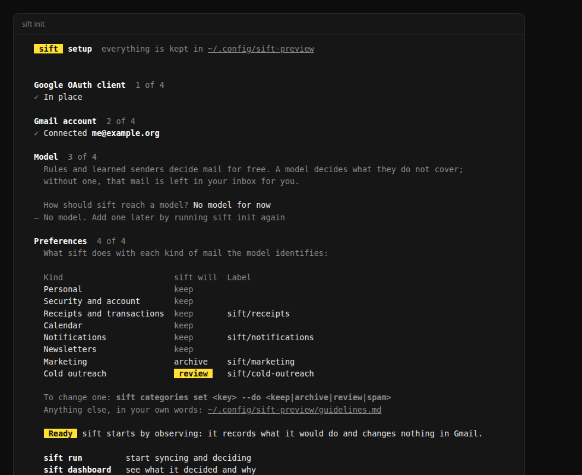
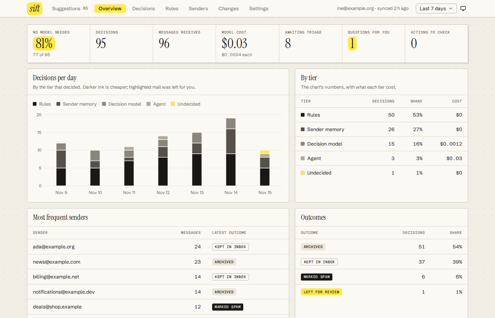

# sift

Self-hosted inbox triage for Gmail. sift labels, archives, filters and unsubscribes on your behalf, asynchronously, and reaches for a language model only when cheaper methods cannot decide.

**Status: early.** sift can connect a Gmail account, sync new inbox mail, decide it with local rules, learned senders and (optionally) one model call per message, and carry the decision out (archive, label, spam) with a full audit log and undo. A local dashboard shows what it decided and did. It has not yet been run against a real mailbox or a real model. Open work is in [TODO.md](TODO.md); the design is in [docs/ARCHITECTURE.md](docs/ARCHITECTURE.md).

## Set up

Requires Node 24 and pnpm.

```bash
pnpm install
```

```bash
pnpm sift init
```

`init` walks you through whatever is not done yet and can be run again at any time:

1. **Google OAuth client.** sift reads your mail through a client you own, so no third party sits in between. `init` takes you through creating one, a page at a time: it gives the link and the values to enter, waits while you do it, then asks you to paste the client's JSON.
2. **Gmail account.** It opens Google's sign-in. If the browser is on another machine and ends on a page that will not load, paste that page's URL back into the terminal.
3. **Model.** Optional. Choose a ChatGPT Plus or Pro subscription, or an API key, then pick a model. Without one, mail that no rule covers is left in your inbox.
4. **Preferences.** It shows what sift does with each kind of mail and where to change it.



Nothing needs an environment variable. Everything sift keeps is in one directory, `~/.config/sift`:

| File | What it is |
| --- | --- |
| `sift.toml` | Settings: the model, whether to act or only observe, how often to check, the dashboard port. |
| `guidelines.md` | Your own words about how to sort your mail. |
| `sift.db` | Rules, categories, learned senders, and the record of every message, decision and change. |
| `google-client.json`, `google/`, `model-auth.json` | Credentials. Owner-only. |

Back the directory up or move it as a unit. To keep it somewhere else, pass `--home <dir>` or set `SIFT_HOME`.

```bash
pnpm sift status
```

## Run

```bash
pnpm sift run
```

sift starts by **observing**: it syncs new mail every 60 seconds, records what it would do, and changes nothing in Gmail. It handles mail that arrives after you connect; it never sweeps what is already in your inbox. Watch the dashboard for a while, then set `act = true` in `sift.toml` (or run `sift run --act` to try it once).

Rules decide mail without any model. A matching `keep` rule always wins.

```bash
pnpm sift rules add --do archive --from-domain example.com --label sift/newsletters
```

What the model does with mail no rule covers is your setting, per category:

```bash
pnpm sift categories
```

```bash
pnpm sift categories set newsletter --do keep
```

After a sender's mail has been put in the same category three times, sift remembers the sender and stops asking the model about them.

Archived mail gets a label such as `sift/newsletters`, mail left for you gets `sift/review`, and spam gets `sift/spam`, so everything sift touched can be found in Gmail itself. sift never deletes mail. Every change is in the audit log and can be reversed:

```bash
pnpm sift log
```

```bash
pnpm sift undo <action-id>
```

Using a ChatGPT subscription from a third-party tool is not something OpenAI documents as supported, so keep an API key as a fallback (`sift login openai --api-key`).

## Dashboard

```bash
pnpm build:web
```

```bash
pnpm sift dashboard
```

Opens a read-only page at http://localhost:8787. It has no login and answers only on localhost.

- **Overview:** decisions per day by tier, how much was decided without a model, model cost, the backlog and the most frequent senders.
- **Decisions:** every decision, searchable by subject or sender and filterable by tier and outcome. Choosing a row shows that message's full history: each decision, its reason and cost, and each mailbox change.
- **Rules:** each rule, what it does, and how often and how recently it matched.



The page is a small React app in `web/` (shadcn/ui on Base UI, Tailwind, Recharts). `pnpm dev:web` runs it with hot reload against a running `sift dashboard`.

## Develop

```bash
pnpm check
```

`pnpm sift <command>` runs the CLI from source. Use `--home ./tmp-home` to keep a development copy apart from your real one.

## Run in Docker

The image keeps its home directory in the `sift-data` volume.

```bash
docker compose -f docker/compose.yaml build
```

Run the same setup inside the container. The published port lets Google's sign-in call back; for the model step choose the device-code login.

```bash
docker compose -f docker/compose.yaml run --rm -it -p 127.0.0.1:8765:8765 sift init --port 8765 --host 0.0.0.0
```

When `init` asks for the Google client file, give a path inside the container; mount the downloaded file with `-v /path/to/client.json:/client.json:ro` and answer `/client.json`.

```bash
docker compose -f docker/compose.yaml up
```

This starts sift and the dashboard at http://localhost:8787.
