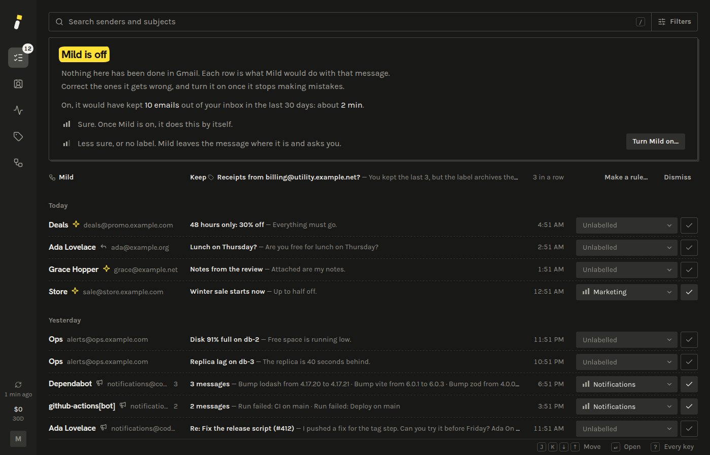

# Sift

Sift helps you manage a Gmail inbox, on a machine you own or on Vercel. Each new message gets a label (Newsletters, Receipts, Cold outreach, or one of your own), and the label decides what happens: keep, archive, mark spam or block the sender. A language model is asked only about mail no rule covers, and what it answers consistently becomes a rule, so it is asked less over time.

It suggests before it acts. Every decision appears in a dashboard, you correct the wrong ones, and nothing in Gmail changes until you turn Sift on. It never deletes mail and cannot send any. Every change it makes can be undone.

**Status: early.** In use on one real inbox, with Sift off; it has not yet been turned on against a real mailbox. Open work is in [TODO.md](TODO.md).



## Set up

[][deploy]

On Vercel, the button above ([docs/VERCEL.md](docs/VERCEL.md) says what it needs first). On a machine of your own, as below; it requires Node 24 and pnpm.

```bash
pnpm install
```

```bash
pnpm sift init
```

`init` walks through these, and can be run again to change any of them:

1. **An encryption key** for the Google and model credentials Sift stores, saved as `SIFT_KEY` in `.env` in the directory you ran it from. Sift finds it only when started from there.
2. **Where Sift runs.** This machine, or a server you reach from another one. Google only signs people in at `localhost` or an HTTPS address, so on a server `init` turns on `tailscale serve`.
3. **A Google OAuth client.** Sift reads your mail through a client you own, so nobody sits in between. `init` gives you each Google Cloud page in turn with the values to enter, and you paste the client's JSON back.
4. **Who can sign in.** Optional: the only Google accounts allowed into the dashboard. Without a list, the first account to sign in connects itself.

Settings are environment variables, kept in `.env` in Sift's home directory (`~/.config/sift`); [docs/CLI.md](docs/CLI.md#files) lists them. Nothing else needs running: the database lives in the home directory too.

```bash
pnpm sift run
```

Open the address it prints and sign in with Google. Signing in is what connects your Gmail account. Then choose a model under Settings (a ChatGPT subscription or an API key); without one, mail no rule covers waits. Sift handles mail that arrives from then on, and pulls in recent mail only when you ask.

## More

- [docs/DASHBOARD.md](docs/DASHBOARD.md): what each screen is for, what Sift leaves in Gmail, and working on the page.
- [docs/CLI.md](docs/CLI.md): the commands, their options, and the files Sift keeps.
- [docs/DOCKER.md](docs/DOCKER.md): running it in a container.
- [docs/VERCEL.md](docs/VERCEL.md): running it on Vercel.
- [docs/RUNTIME.md](docs/RUNTIME.md): how one codebase runs as one process or as functions.
- [docs/DEPLOY.md](docs/DEPLOY.md): upgrading, backing up and restoring.
- [docs/SECRETS.md](docs/SECRETS.md): encrypting stored credentials with a key you supply.
- [docs/ARCHITECTURE.md](docs/ARCHITECTURE.md): how it decides, and why it is built this way.
- [AGENTS.md](AGENTS.md): the rules for changing it. `pnpm check` is the gate.

[deploy]: https://vercel.com/new/clone?repository-url=https%3A%2F%2Fgithub.com%2Fdcramer%2Fsift&project-name=sift&repository-name=sift&env=SIFT_GOOGLE_CLIENT_ID%2CSIFT_GOOGLE_CLIENT_SECRET%2CSIFT_DASHBOARD_ALLOW%2CSIFT_KEY%2CSIFT_SESSION_SECRET%2CCRON_SECRET%2CENABLE_EXPERIMENTAL_COREPACK&envDefaults=%7B%22ENABLE_EXPERIMENTAL_COREPACK%22%3A%221%22%7D&envDescription=Your%20Google%20OAuth%20client%2C%20the%20accounts%20that%20may%20sign%20in%2C%20and%20three%20secrets.&envLink=https%3A%2F%2Fgithub.com%2Fdcramer%2Fsift%2Fblob%2Fmain%2Fdocs%2FVERCEL.md%23one-click&products=%5B%7B%22type%22%3A%22integration%22%2C%22protocol%22%3A%22storage%22%2C%22productSlug%22%3A%22neon%22%2C%22integrationSlug%22%3A%22neon%22%7D%2C%7B%22type%22%3A%22integration%22%2C%22protocol%22%3A%22storage%22%2C%22productSlug%22%3A%22upstash-kv%22%2C%22integrationSlug%22%3A%22upstash%22%7D%5D
