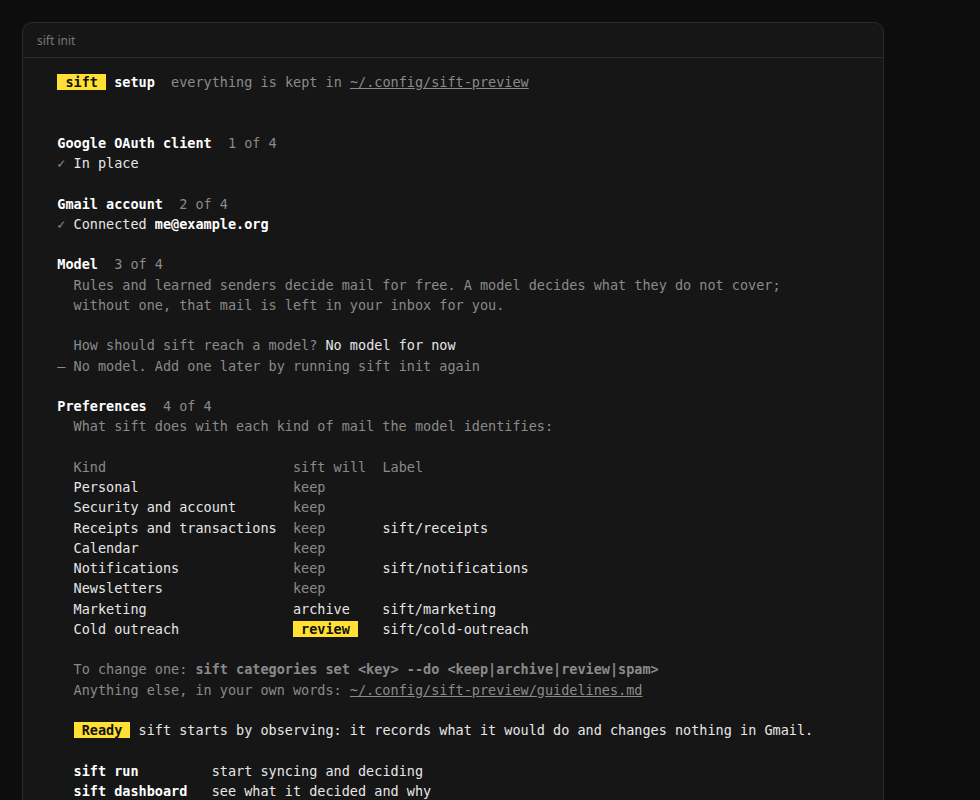

# Command line

The CLI sets sift up and starts it. Rules, labels, the record of changes, undo and the choice of model are in the [dashboard](DASHBOARD.md) and have no command.

From a checkout, `pnpm sift <command>` runs it from source.

| Command | What it does |
| --- | --- |
| `sift init` | Set sift up. A first run walks through every step; one stopped part-way carries on from where it stopped. Once setup is finished it lists the steps with what each is set to and redoes the one you pick. |
| `sift run` | Sort mail and serve the dashboard. The one process to keep running. |
| `sift status` | What is set up, and how much sift has recorded. |
| `sift dev` | `run` for working on sift: restarts when server code changes, rebuilds and reloads the page when page code changes. Takes `run`'s options. |
| `sift dashboard` | Serve the dashboard without sorting mail. Takes `--port` and `--host`. |

`--home <dir>` works with every command and says where sift keeps its files. When working on sift, give it a scratch directory so your real mail is left alone.

## `sift run`

| Option | Effect |
| --- | --- |
| `--act` | Carry decisions out in Gmail for this run, whatever `sift.toml` says. |
| `--observe` | Only suggest for this run, whatever `sift.toml` says. |
| `--once` | One pass over every account, then exit, without serving the dashboard. Exits 1 if an account failed. |
| `--interval <seconds>` | Time between passes for this run. At least 5. |
| `--port <port>` | The dashboard's port for this run. |
| `--host <address>` | Listen on this address instead of what `sift.toml` says. A container uses `0.0.0.0` and lets its port mapping decide who can reach it. |
| `--no-dashboard` | Sort mail without serving the dashboard. |

Settings are read again before every pass, so a change made in the dashboard or in `sift.toml` applies without a restart. An option given here wins for as long as the process runs.

## Models

The model step of `init` signs in to a provider and offers its models, the newest small one first. The dashboard's Settings switches between the models you are signed in to. Using a ChatGPT subscription from a third-party tool is not something OpenAI documents as supported; an API key is the fallback.

## Files

Nothing needs an environment variable. Everything sift keeps is in one directory, `~/.config/sift` (`$XDG_CONFIG_HOME/sift`) unless `--home` or `SIFT_HOME` says otherwise. Back it up or move it as a unit.

| File | What it is |
| --- | --- |
| `sift.toml` | Settings: the model, whether to act or only suggest, how often to check, the dashboard's port and address, and who can sign in. Unknown keys are errors. |
| `guidelines.md` | Your own words about how to sort your mail. The model reads it before each message. |
| `sift.db` | Labels, rules, the record of every message, decision and change, and the full content of mail you answered for. |
| `google-client.json`, `google/`, `model-auth.json`, `dashboard-key` | Credentials and the session secret. Owner-only. |
| `setup.json` | How far `init` has got. |
