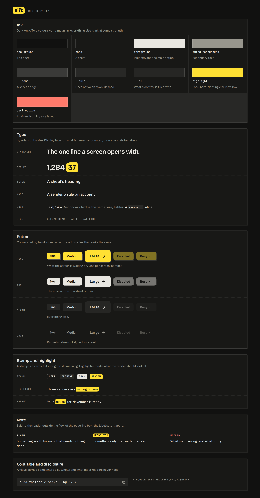

# Design system

The dashboard is built from one small set of parts, in `web/src/system/`. Every part, in every state, is on the specimen page: open the dashboard at `/#system`.

## What it is going for

A proof sheet on a dark desk: ink on near-black, one highlighter pen, hard edges. Calm. Weight and size do the work.

- **Dark only.**
- **Two colours mean something.** Yellow (`highlight`) means "look here": the name, the current section, the headline figure, what is waiting on the reader, a search match. Red (`destructive`) means a failure. Nothing else is coloured; everything else is the ink colour at some strength.
- **As little chrome as it takes.** A sheet has a frame; inside it, space and type separate things before any line does. Controls are filled (`--fill`), not outlined. Notes and headings have no box and no rule. The only lines inside a sheet are faint dashes between rows (`--rule`).
- **Lines are ink, thinned.** `--frame` for a sheet's edge, `--rule` between rows. Never a separate grey.
- **One shadow.** `--edge`: hard, offset down and right, the edge of the sheet beneath. A `mark` button is raised by the same edge and pressing pushes it down.
- **Things you press have hand-cut corners** (`--cut-control`); the highlighter stroke has its own (`--cut`). Surfaces are square.
- **Type is by role.** Display face (`.statement`, `.figure`, `.title`, `.name`, the wordmark) for what is named or counted; text face for reading; mono small capitals (`.slug`) for labels and column heads; mono for anything typed or pasted.
- No app bar, no gradients, no pills, no icons as decoration.

Tokens and the role classes are in `web/src/index.css`.

## Parts

| Part | Use |
| --- | --- |
| `Button` | `mark`: what the screen is waiting on, one per screen at most. `ink`: the main action of a sheet or row. `plain`: everything else, filled not outlined. `quiet`: repeated down a list, and ways out. With `href` it is a link. `busy` while a press is being acted on. |
| `Sheet`, `SheetHead` | The surface everything sits on. Rows inside take the class `row`. |
| `Note` | Said to the reader outside the flow: `plain`, `look` (needs them), `failure`. No box. |
| `Stamp` | A short verdict. Weight is meaning: `outline`, `tint`, `ink`; `look` for what is left to the reader. |
| `Highlight`, `Marked` | A stroke of highlighter; a search term marked in text. |
| `Code`, `Copyable` | Something typed, inline; a value carried somewhere else whole, with a copy button where the browser allows one. |
| `Disclosure` | What most readers never need, folded under the question that leads to it. |
| `Wordmark` | The name. |

## Rules for adding to it

- Build screens from these parts. If a screen needs something they cannot do, add or extend a part here, with its states (hover, focus, pressed, disabled, busy, empty, failed), and add it to the specimen page in the same change.
- A part says when to use it in its doc comment; that is the line the specimen page shows.
- No inline styles, no colours or radii written into a view. If a value is missing, it is a missing token.
- `web/src/components/ui/` is what remains of the generated shadcn components (select, input, tabs, table, the message drawer, chart), skinned by rules at the bottom of `index.css`. They are to be replaced by parts here, one at a time; do not add to them.
- Motion is short (80 to 120ms), only on things pressed, and off under `prefers-reduced-motion`.
