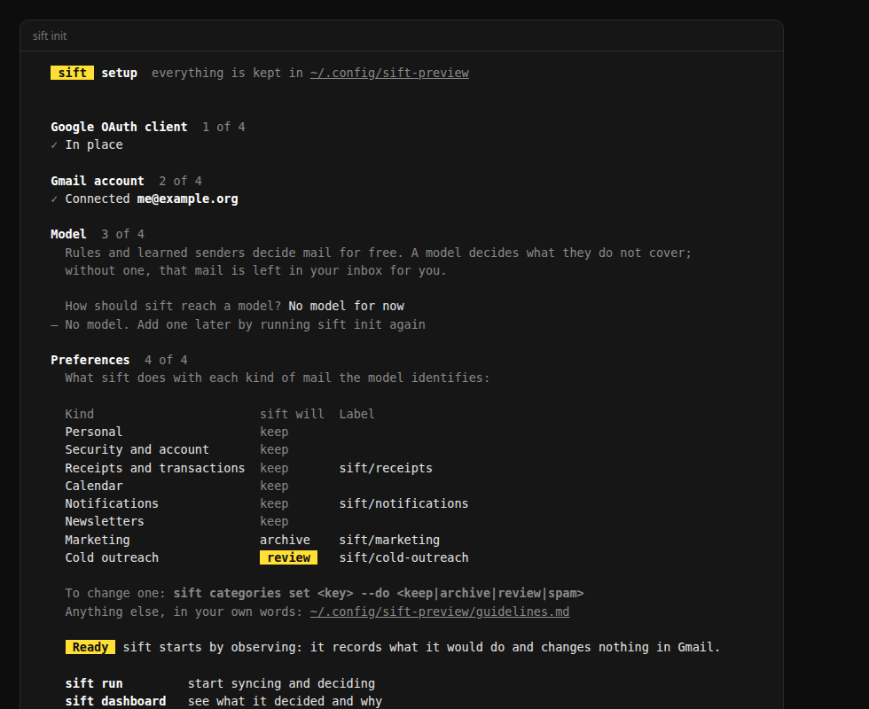

# Command line

The CLI sets Sift up and starts it. Rules, labels, the record of changes, undo and the choice of model are in the [dashboard](dashboard.md) and have no command.

From a checkout, `pnpm sift <command>` runs it from source.

| Command | What it does |
| --- | --- |
| `sift init` | Set Sift up. A first run walks through every step; one stopped part-way carries on from where it stopped. Once setup is finished it lists the steps with what each is set to and redoes the one you pick. |
| `sift run` | Read and classify mail, and serve the dashboard. The one process to keep running. |
| `sift status` | What is set up, and how much Sift has recorded. |
| `sift dev` | `run` for working on Sift: restarts when server code changes, rebuilds and reloads the page when page code changes. Takes `run`'s options. |
| `sift reset-db` | Renames the local database folder to `database.<time>`, so Sift starts a new, empty one. For a database an earlier Sift made with migrations since replaced. Refused while Sift has it open; not for a Postgres server. `pnpm db:reset` runs it. |

`--home <dir>` works with every command and says where Sift keeps its files. When working on Sift, give it a scratch directory so your real mail is left alone.

## `sift run`

| Option | Effect |
| --- | --- |
| `--once` | One tick, then exit, without serving the dashboard: everything due (a pass for each mailbox with a label of its own, upkeep, going through an inbox, test runs), each piece starting nothing new after 5 minutes. Exits 1 if a piece failed. |
| `--port <port>` | The dashboard's port for this run. |
| `--host <address>` | Listen on this address instead of `SIFT_DASHBOARD_HOST`. A container uses `0.0.0.0` and lets its port mapping decide who can reach it. |
| `--no-dashboard` | Read and classify mail without serving the dashboard. |

A pass runs every minute, each person's mailboxes changed in Gmail only if that person turned Sift on under Settings in the dashboard. A change there applies from the next pass, without a restart; a change to a setting needs one.

## Models

Each person signs in to a model and chooses one under Settings in the dashboard: ChatGPT, or an OpenAI, Anthropic, OpenRouter or Vercel AI Gateway API key. The newest small model is offered first.

ChatGPT is signed in to one way per install, set by `SIFT_CHATGPT_SIGN_IN`:

- `device-code`, the default: a code entered at OpenAI. It reaches ChatGPT through Codex's backend, which OpenAI does not document for other tools.
- `redirect`: OpenAI's Sign in with ChatGPT, on its documented API. OpenAI sends the browser back only to `127.0.0.1` on the person's own machine, so they land on a page that will not load and paste its address into the dashboard.

Changing it signs everyone out of ChatGPT.

## Files

Nothing needs an environment variable. Everything Sift keeps is in one directory, `~/.config/sift` (`$XDG_CONFIG_HOME/sift`) unless `--home` or `SIFT_HOME` says otherwise. Back it up or move it as a unit.

| File | What it is |
| --- | --- |
| `.env` | Settings, as variables: the dashboard's port and address (`SIFT_DASHBOARD_PORT`, `SIFT_DASHBOARD_HOST`), a Postgres server and the role that migrates it (`DATABASE_URL`, `DATABASE_MIGRATION_URL`), a Redis server (`REDIS_URL`), `SIFT_CHATGPT_SIGN_IN`, `SENTRY_DSN` (set from `sift init` once setup is finished), and `SIFT_CLOUD`, `true` on a Sift run for other people, which gives it terms, a privacy policy and a security page. The environment wins over it. Whether Sift is on is each person's, under Settings in the dashboard. |
| `database/` | The database (PGlite), unless `DATABASE_URL` names a Postgres server: who has which mailbox, and for each person their sign-ins (encrypted), model, labels, rules, the record of every message, decision and change, and the full content of mail they answered for. |
| `database.lock` | Which process has the database open. |
| `google-client.json`, `dashboard-key` | The Google client and the session secret. Owner-only. |
| `setup.json` | How far `init` has got. |
