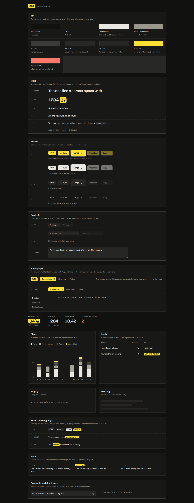

# Design system

The dashboard is built from one small set of parts, in `web/src/system/`. Every part, in every state, is on the specimen page: open the dashboard at `/system`. It needs no sign-in: it shows only made-up examples and asks the server for no data.

## What it is going for

A proof sheet on a dark desk: ink on near-black, one highlighter pen, hard edges. Calm. Weight and size do the work.

- **Dark only.**
- **Two colours mean something.** Yellow (`highlight`) means "look here": the name, the headline figure, what is waiting on the reader, a search match, the label Activity is narrowed to in its chart. Red (`destructive`) means a failure, or deleting what nothing brings back (`DeleteButton`). Nothing else is coloured; everything else is the ink colour at some strength. The one exception is a mailbox's icon (`MailboxIcon`), in its domain's own colours: it is the domain's mark, not Mild's, and is how a glance tells which mailbox mail came to.
- **As little chrome as it takes.** Nothing on the page has a fill of its own: a list sits straight on it, and a sheet is set apart by a thin frame alone. Only what floats above the page (a panel, a dialog, a menu, a toast) is filled, so it can cover what is under it; the design-system test fails on a surface fill in any other part, and the theme has no grey surface tokens to reach for. A sheet is for a group of settings, not for a list. Inside it, space and type separate things before any line does. Controls are filled (`--fill`), not outlined. Notes and headings have no box and no rule. The only lines inside a sheet are faint dashes between rows (`--rule`).
- **Ink at three strengths.** `--foreground` for what a thing says; `--supporting` for what supports it (a preview, a hint, Mild's label); `--faint` for what only places it (when, an address, a count, a day's heading). `--muted-foreground` is the quiet ink where it is drawn: `--supporting` on the page, and in a table's rows `--faint`, so a row reads in three steps with no more bold. A list's answer (Mild's label) reads at `--supporting` even in a row.
- **Lines are ink, thinned.** `--frame` for a sheet's edge, `--rule` between rows. Never a separate grey.
- **What floats stands off the page.** A panel, a dialog or a menu is a step lighter than the page (`--card`, `--popover`), and what it covers is dimmed darker than the page (`--scrim`), so the layer is the lightest thing on the screen.
- **One shadow.** `--edge`: hard, offset down and right, the edge of the sheet beneath. It belongs to sheets and to what floats (a dialog, a menu); a dialog shows twice as much of it, as it floats higher. Buttons have none: the highlighted button is a flat stroke of yellow, like the name. Any other shadow fails the design-system test.
- **One word for each thing.** What Mild does with mail (Keep, Archive, Digest, Spam, Block, Leave in inbox for mail left alone without a label, Unlabelled when no tier was sure which label), where a decision got to (Suggested, Done, Undone, Not done…), how a sender and the reader know each other and which tier decided each have exactly one name, kept in `web/src/lib/format.ts` and used in every filter, select and column. What Mild does is its icon and its word (`Does`), and only the action: "Archive", never "Archive + unsubscribe"; what comes with an action is said where the label or rule is edited. A verdict is the action, then the label: "**Archive** as Marketing". A sentence uses the matching phrase (`willBe`). Never write one of these words in a view.
- **Say what the reader can use.** A list shows what something is, what Mild said, why, where it got to and when. Model names, token counts, cost per message, confidence and change ids belong in the reader's history, not in a row.
- **Corners are small and even** (`--corner`, 3px) on everything you press or type in. Only the highlighter stroke and the wordmark are cut by hand (`--cut`). Surfaces are square.
- **Type is by role, set as Peated sets it.** Karla carries everything read. Hanken Grotesk, bold, is for what is named or counted: the splash's one line (`.display`, 44 to 88px), a page's title (`.statement`, 32 to 40px), a dialog's (`.title`, 26px), a section's heading (`.heading`, 22px, clearly larger than a name so it never reads as the first row), names (`.name`), figures. Display type is tracked tight, tighter as it grows (−0.02em for a name to −0.04em for a title and −0.05em for `.display`); that is most of what makes it look set rather than typed. A figure's label (`.slug`) is Karla at the supporting size in lighter ink. A column head (`Th`) is Karla in capitals, 11px semibold, a little tracked, in quiet ink: the one thing under 12px, since capitals read larger than their size. IBM Plex Mono is for anything typed or pasted, and nothing else. The wordmark alone is in Bricolage Grotesque. Text is 16px (`text-base`), what supports it 14px (`text-sm`, what is typed or chosen in a control too, but 16px on a touch screen, where a phone zooms in on a smaller input), an opened message 17px (`text-reading`), keycaps 12px (`text-label`), column heads 11px (`text-head`, `Th` alone), and nothing else under 12px. The pages before the dashboard (`Entry`) set their supporting text at 15px and their controls at 40px. Those are the only sizes a class can set; titles, figures and the wordmark are role classes. A size typed by eye (`text-[13px]`) fails the design-system test. A button's words are semibold; a select's value is not.
- **One height for controls.** Everything pressed or typed into in a row or a toolbar is `--control` high (32px), so buttons, selects and inputs line up. `lg` is for the one action a screen is about. Somewhere to type (an input, a text area, the search bar) is outlined and empty; anything pressed, a select included, is filled (`--fill`), and stronger on hover. A button is a verb in semibold; a select shows its value in regular weight beside a chevron, so the two never read alike. What cannot be pressed now is not filled: a disabled button is an outline in quiet ink, and a quiet one dims.
- **As wide as the window.** A screen beside the rail runs to the right edge, with no column of its own: a list uses the room, and so does the `Reader`, as Gmail's does: mail written to a width centres itself in it. Only a page with one thing on it centres a column: `Splash`, `Entry`, `Onboarding` and `Document`.
- No app bar, no gradients, no pills, no icons as decoration. An icon that names something (an action in `Does`, a section in the rail, named when pointed at) is not decoration. The one decoration is a doodle where a screen has nothing else to show, drawn as [brand.md](brand.md) says.

Tokens and the role classes are in `web/src/index.css`.

## Parts

| Part                                                                                                    | Use                                                                                                                                                                                                                                                                                                                                                                                                                                                                                                                                                                                                                                                                                                                                                                                                                                                                                                                                                                                                                                                                                                                                                                                                                                                                                                                                                                                                                                                                                                                                                                                                                                                                                                                                                                                                                                                                                                                                                                                                                                                                                                                                                                                                                                                                                                                                                                                                                                               |
| ------------------------------------------------------------------------------------------------------- | ------------------------------------------------------------------------------------------------------------------------------------------------------------------------------------------------------------------------------------------------------------------------------------------------------------------------------------------------------------------------------------------------------------------------------------------------------------------------------------------------------------------------------------------------------------------------------------------------------------------------------------------------------------------------------------------------------------------------------------------------------------------------------------------------------------------------------------------------------------------------------------------------------------------------------------------------------------------------------------------------------------------------------------------------------------------------------------------------------------------------------------------------------------------------------------------------------------------------------------------------------------------------------------------------------------------------------------------------------------------------------------------------------------------------------------------------------------------------------------------------------------------------------------------------------------------------------------------------------------------------------------------------------------------------------------------------------------------------------------------------------------------------------------------------------------------------------------------------------------------------------------------------------------------------------------------------------------------------------------------------------------------------------------------------------------------------------------------------------------------------------------------------------------------------------------------------------------------------------------------------------------------------------------------------------------------------------------------------------------------------------------------------------------------------------------------------- |
| `Button`                                                                                                | `mark`: what the screen is waiting on, one per screen at most, never down a list. `ink`: what finishes a dialog or form. `plain`: a page's own action (adding to its list), and anything else said once. `quiet`: repeated down a list, firmer when its row is pointed at, and ways out. `bare`: an icon press in a `RowPresses` (`size="tray"`), filled only when pointed at itself. `danger` and `destroy` are `DeleteButton`'s alone. With `href` it is a link. `busy` while a press is being acted on. `Finish` is the `ink` press that finishes what is written in a layer (the composer's Send), which ⌘↵ or Ctrl ↵ presses from anywhere in it.                                                                                                                                                                                                                                                                                                                                                                                                                                                                                                                                                                                                                                                                                                                                                                                                                                                                                                                                                                                                                                                                                                                                                                                                                                                                                                                                                                                                                                                                                                                                                                                                                                                                                                                                                                                            |
| `DeleteButton`                                                                                          | Every press that deletes what nothing brings back: a rule, a label, a model sign-in, a mailbox, the account. Its words in red with an ellipsis, or down a list a quiet trash can like the row's other actions, so a list is not striped red. Either opens the same question: a dialog titled with it ("Remove this rule?"), what it is under that when the title does not say, what else goes that the reader could not tell (a rule's Gmail filter, a label's rules), and the press that does it, filled red with the same words. With nothing to type, that press has the focus. Deleting a mailbox or the account, which takes the record of mail with it, asks for the address typed first. A failure stays in the dialog.                                                                                                                                                                                                                                                                                                                                                                                                                                                                                                                                                                                                                                                                                                                                                                                                                                                                                                                                                                                                                                                                                                                                                                                                                                                                                                                                                                                                                                                                                                                                                                                                                                                                                                                    |
| `ConfirmButton`, `Ask`                                                                                  | A press that is hard to take back but deletes nothing (turning Mild on). It asks in place, with the same words on the button that does it. `Ask` is that question alone, for a press that asks only when what it acts on needs it (Send, on mail with no subject). |
| `Select`, `Input`, `TextArea`, `Check`                                                                  | Controls. `Select` is for a short list; `icons` puts an icon before a choice (an action's, from `ActionIcon`), in the list and once chosen.                                                                                                                                                                                                                                                                                                                                                                                                                                                                                                                                                                                                                                                                                                                                                                                                                                                                                                                                                                                                                                                                                                                                                                                                                                                                                                                                                                                                                                                                                                                                                                                                                                                                                                                                                                                                                                                                                                                                                                                                                                                                                                                                                                                                                                                                                                       |
| `ChoiceGroup`                                                                                           | A few choices seen at once, one on: where a sender stands, how to read a message (Text or HTML). `clearable` when none is a choice too. With `notes` they are rows, each with a quieter line saying what sets it apart and a tick on the one that is on: a model and what it costs.                                                                                                                                                                                                                                                                                                                                                                                                                                                                                                                                                                                                                                                                                                                                                                                                                                                                                                                                                                                                                                                                                                                                                                                                                                                                                                                                                                                                                                                                                                                                                                                                                                                                                                                                                                                                                                                                                                                                                                                                                                                                                                                                                               |
| `Field`, `Form`                                                                                         | A form is a column of fields with what finishes it last. A field is its label, its controls, what follows from the answer (`hint`) and what is wrong (`error`). `inline` puts the label beside the controls, for a short form in a narrow column.                                                                                                                                                                                                                                                                                                                                                                                                                                                                                                                                                                                                                                                                                                                                                                                                                                                                                                                                                                                                                                                                                                                                                                                                                                                                                                                                                                                                                                                                                                                                                                                                                                                                                                                                                                                                                                                                                                                                                                                                                                                                                                                                                                                                 |
| `FieldGroup`                                                                                            | A long form in parts, each under its name (`.name` size), a rule above every part after the first: the rule dialog's Which mail, What it is, What happens, in the order a rule applies. Not for a short form; on a phone it is what keeps a long one readable.                                                                                                                                                                                                                                                                                                                                                                                                                                                                                                                                                                                                                                                                                                                                                                                                                                                                                                                                                                                                                                                                                                                                                                                                                                                                                                                                                                                                                                                                                                                                                                                                                                                                                                                                                                                                                                                                                                                                                                                                                                                                                                                                                                                    |
| `Rail`                                                                                                  | The sections, down the left of every screen on a desktop (from `md`, where the rest of the system leaves its phone layout: at least 48rem wide and 30rem tall, so a phone on its side keeps the phone's layout, which `phone:` names). No fill: a `--rule` line, as faint as the one between rows, sets it apart, as tall as the window and staying put while the page scrolls. Mild's icon (`Emblem`, the app's own, as the rail is too narrow for the name) at its top, level with the page's search bar and linking to the first section; with Inbox on, Compose under it, a filled press shaped like a section, with no keycap (`?` lists `C`); then each section as its icon alone in a rounded square, named in a `Tooltip` to its right, the current one filled in ink (`--fill-strong`): yellow is for what waits on the reader, not for where they are; For review's count a bubble in ink on its icon's corner, so the icons stay in one column. At its foot, Mild's line stacked (`components/status.tsx`: a sync icon over how long since it synced, each mailbox's time when pointed at; then the model's cost over 30 days, `$4.12` over `30D`, which previews the time Mild saved over 24 hours, 7 days and 30 days with its trend, then the cost over the same windows, and links to Activity), then who is signed in, as an `Avatar` that opens a `Menu`, which also chooses the mailbox. The line counts on by itself, by the minute, never the second. Given no sections it is the name alone: the page before it knows who is signed in.                                                                                                                                                                                                                                                                                                                                                                                                                                                                                                                                                                                                                                                                                                                                                                                                                                                                                                                                                                                                                                                                                                      |
| `Masthead`, `BarSlot`                                                                                   | The top of every screen on a phone, where the rail is not shown (see Narrow screens). `BarSlot` is its room for a list's search, given by whatever draws it.                                                                                                                                                                                                                                                                                                                                                                                                                                                                                                                                                                                                                                                                                                                                                                                                                                                                                                                                                                                                                                                                                                                                                                                                                                                                                                                                                                                                                                                                                                                                                                                                                                                                                                                                                                                                                                                                                                                                                                                                                                                                                                                                                                                                                                                                                      |
| `TabBar`                                                                                                | The sections along the foot of every screen on a phone, under the thumb (see Narrow screens).                                                                                                                                                                                                                                                                                                                                                                                                                                                                                                                                                                                                                                                                                                                                                                                                                                                                                                                                                                                                                                                                                                                                                                                                                                                                                                                                                                                                                                                                                                                                                                                                                                                                                                                                                                                                                                                                                                                                                                                                                                                                                                                                                                                                                                                                                                                                                     |
| `FloatingPress`                                                                                         | A screen's one way to begin something new on a phone (Compose, Add a rule, Add labels), floating in the bottom right, in place of the button a desktop has beside the search.                                                                                                                                                                                                                                                                                                                                                                                                                                                                                                                                                                                                                                                                                                                                                                                                                                                                                                                                                                                                                                                                                                                                                                                                                                                                                                                                                                                                                                                                                                                                                                                                                                                                                                                                                                                                                                                                                                                                                                                                                                                                                                                                                                                                                                                                     |
| `MailboxSwitch`                                                                                         | Which of the person's mailboxes every list shows, for someone with more than one: a `Select` of All mailboxes, set apart, then each address. Kept in the browser, not the address or the server: it is the reader's convenience. Every read under it asks for that mailbox alone, and a mailbox that is no longer theirs is All. On a desktop it is not a control of its own but the first group of the account menu (`mailboxChoices`), the one shown ticked: it is the reader's, like the account, and holds on every page. Mild's line, Settings and the account stay for all of them.                                                                                                                                                                                                                                                                                                                                                                                                                                                                                                                                                                                                                                                                                                                                                                                                                                                                                                                                                                                                                                                                                                                                                                                                                                                                                                                                                                                                                                                                                                                                                                                                                                                                                                                                                                                                                                                         |
| `Notice`                                                                                                | A state of Mild itself, true on every screen, at the top of the page over its title: Mild cannot be reached (plain ink, a pulse: it mends itself), a sign-in has expired or Google will end it within two days (`look`, with a link: the reader mends it).                                                                                                                                                                                                                                                                                                                                                                                                                                                                                                                                                                                                                                                                                                                                                                                                                                                                                                                                                                                                                                                                                                                                                                                                                                                                                                                                                                                                                                                                                                                                                                                                                                                                                                                                                                                                                                                                                                                                                                                                                                                                                                                                                                                        |
| `PageHeader`                                                                                            | The top of a page about one thing the rail does not name (a sender, a domain, the specimen page): its title, and on the right the page's own action or one quiet line of numbers, centred on each other. No count beside the title (the sections have it) and no sentence under it that says what the page is or how to use it; `meta` is only for naming the page's subject, such as a sender's address. While the dashboard is narrowed to one mailbox, its address follows the title, so a list that looks short says why.                                                                                                                                                                                                                                                                                                                                                                                                                                                                                                                                                                                                                                                                                                                                                                                                                                                                                                                                                                                                                                                                                                                                                                                                                                                                                                                                                                                                                                                                                                                                                                                                                                                                                                                                                                                                                                                                                                                     |
| `Section`                                                                                               | A part of a page or a panel under its own heading, with a count and at most one action beside it. Space sets it apart.                                                                                                                                                                                                                                                                                                                                                                                                                                                                                                                                                                                                                                                                                                                                                                                                                                                                                                                                                                                                                                                                                                                                                                                                                                                                                                                                                                                                                                                                                                                                                                                                                                                                                                                                                                                                                                                                                                                                                                                                                                                                                                                                                                                                                                                                                                                            |
| `ListPage`, `ListView`, `FilterGroup`                                                                   | **How every screen shows many of one thing.** `ListPage` names the page and holds its own action, drawn by the screen's route on the server; `ListView` inside it is the list. On a desktop the rail already names the page, so the name is for screen readers alone and the list starts at the top: the page's action, and the mailbox it is narrowed to, end the search bar, or sit on a line of their own at the top where something comes before the bar (Activity's chart, which its period governs too) or the list has none. Its search and filters are kept in the address (`useParam`), so a narrowed list can be bookmarked. Anything the page shows first (`intro`), one outlined bar holding the search and the Filters button, then the rows. `view` adds a few ways to see the list as segments at the end of the bar (Activity's Changed and Everything); use it for whole alternative lists, filters for narrowing one. The filter button opens a panel on the right that pushes the list left. Filters that are on show as a count on the button and, when the panel is closed, as a line of chips that each clear one. While rows are selected (`RowCheck`), `selected` puts what to do with them in the search's place: how many, a quiet press with its key for each, and Select none; the rows do not move.                                                                                                                                                                                                                                                                                                                                                                                                                                                                                                                                                                                                                                                                                                                                                                                                                                                                                                                                                                                                                                                                                                                  |
| `Pager`                                                                                                 | Under a list too long for one page (Activity, Contacts): which rows these are of how many, then Newer and Older. The page is in the address (`?page=2`), and narrowing the list goes back to the first. Nothing while the list fits on one. A list read as it is scrolled (Inbox) has `More` instead.                                                                                                                                                                                                                                                                                                                                                                                                                                                                                                                                                                                                                                                                                                                                                                                                                                                                                                                                                                                                                                                                                                                                                                                                                                                                                                                                                                                                                                                                                                                                                                                                                                                                                                                                                                                                                                                                                                                                                                                                                                                                                                                                             |
| `Table`, `Heads`, `Tr`, `Th`, `Td`, `TrGroup`, `Sub`, `OnPhone`, `RowActions`, `RowPresses`, `RowCheck` | Rows of the same kind of thing, one row per item: the only way to show a list. No surface of its own; on the page a row reaches a little past its text on both sides (`--bleed`), so the hover has room around what it holds, while the rule under it stays in line with the text. `Tr onOpen` makes the whole row pressable; the row pointed at is a faint band (`--row`) and the row the keys are on a firmer one (`--row-strong`), never an outline, both quieter than any control so a control on the row, and its hover, stand off it. In a row the quiet ink is `--faint`. `Sub` is a quieter second line in a cell; cells sit in the middle of their row, so a one-line cell beside a two-line one lines up with the pair. `RowActions` is the last cell: quiet presses that act without opening the row, always visible. `RowPresses` is the last cell of a list of mail: it says when, and while the row is pointed at or the keys are on it, `bare` icon presses take its place, as a mail app's do, each named in a `Tooltip`, on a solid block a shade lighter than the row with its edge on the time's, reaching left over the row's text as far as they need. Its `lead` goes first on the block, set apart by a rule: what the mail is (`LabelPick`), so the presses never cover it and the list needs no column for it. Its `mark` sits before the time in a slot of its own, so a column of them lines up (Inbox's yellow `Hint` on mail Mild could not place). On a touch screen it says when and nothing more. A `dense` table (Inbox) sets each row as one line of 14px type, close. Every table has `Heads`, one `Th` per column. A list that reads as plain rows keeps them for screen readers alone; one with two figures or dates beside its first column shows them (`shown`), as Rules and Labels do, since a number alone does not say what it counts: `wide` where a phone drops those columns, `always` where it keeps some. On a page of several tables in one layout (Labels) only the first shows them. A head or a cell takes `says` for a `Tooltip`; nothing marks that it has one. `TrGroup` heads the rows after it, such as a day, inside the one table, as a small quiet line so the rows read as one run, so J and K and the columns run through every group. `RowCheck` is the first cell of a row that can be selected with others for a press on all of them (Inbox): a check alone, with no keycap beside it or room kept for one (X selects the row the keys are on, and `?` lists it); pressing it never opens the row. A selected row is filled (`Tr selected`), as a pointed-at one is. `RowPresses` draws its presses the first time its row is pointed at or the keys reach it: a label menu and three tooltips on every row of a list's first screen held a phone's processor most of a second. |
| `Swipe`                                                                                                 | A row of mail on a phone, slid sideways under the thumb as a mail app's: a short swipe stops with a press showing in ink (Archive at its end, swiped left; Read or Unread at its start, swiped right), and one to the edge does it, with Undo on its toast. Built on the browser's own scrolling and snapping. Only what is undone by its toast, and never anything that acts on a sender. One row shows a press at a time, and a press on the row closes it. Wider, rows have their `RowPresses`.                                                                                                                                                                                                                                                                                                                                                                                                                                                                                                                                                                                                                                                                                                                                                                                                                                                                                                                                                                                                                                                                                                                                                                                                                                                                                                                                                                                                                                                                                                                                                                                                                                                                                                                                                                                                                                                                                                                                                |
| `AnswerPicker`                                                                                          | Saying what a message is: a dropdown that starts on the reader's answer where they gave one, else Mild's label: Leave in inbox first, set apart, then what else it might be (each with a `Meter`), then every other label, and last a way to add a label; and a check that agrees. Picking from the list is the answer, so agreeing is one press and a change is two. The answer on every For review row and in the reader's `AnswerRow`; it is sent only when its toast goes, so Undo has nothing to take back, except in Inbox, where it is saved at once and picking again is the undo.                                                                                                                                                                                                                                                                                                                                                                                                                                                                                                                                                                                                                                                                                                                                                                                                                                                                                                                                                                                                                                                                                                                                                                                                                                                                                                                                                                                                                                                                                                                                                                                                                                                                                                                                                                                                                                                        |
| `LabelPick`                                                                                             | What a message is, changed in place where it is read: from the block `RowPresses` shows on a pointed-at row (its `lead`), and in the Inbox reader's toolbar (`size="toolbar"`, `ReaderBar`'s `label`). The meter and the label, or Unlabelled, and a chevron; the same list as `AnswerPicker`'s, `extras` last (Add a label…, and in the reader's toolbar Make a rule…), no check. Picking saves it at once; picking again is the undo, and a failed save goes back. Not on a phone's rows, where the reader has it. |
| `Meter`                                                                                                 | How sure Mild is of a label, in three steps of ink, before the label it qualifies. Its name (Unsure, Fairly sure, Sure) is read out; the steps come from `sureness` in `lib/format.ts`. Full means Mild does it by itself while on; mail it would hold is never full. Before Unlabelled in a column of answers it is the bars' room alone, so the words line up.                                                                                                                                                                                                                                                                                                                                                                                                                                                                                                                                                                                                                                                                                                                                                                                                                                                                                                                                                                                                                                                                                                                                                                                                                                                                                                                                                                                                                                                                                                                                                                                                                                                                                                                                                                                                                                                                                                                                                                                                                                                                                  |
| `Facts`, `Fact`                                                                                         | What is known about one thing, as terms and values: a sender. Leave a fact out rather than give it no value.                                                                                                                                                                                                                                                                                                                                                                                                                                                                                                                                                                                                                                                                                                                                                                                                                                                                                                                                                                                                                                                                                                                                                                                                                                                                                                                                                                                                                                                                                                                                                                                                                                                                                                                                                                                                                                                                                                                                                                                                                                                                                                                                                                                                                                                                                                                                      |
| `Timeline`, `TimelineEvent`                                                                             | What happened to one thing, oldest first, each with at most one press (Undo).                                                                                                                                                                                                                                                                                                                                                                                                                                                                                                                                                                                                                                                                                                                                                                                                                                                                                                                                                                                                                                                                                                                                                                                                                                                                                                                                                                                                                                                                                                                                                                                                                                                                                                                                                                                                                                                                                                                                                                                                                                                                                                                                                                                                                                                                                                                                                                     |
| `Splash`                                                                                                | The first page of someone not signed in, in place of `Entry` while sign-in can start: no sheet, the name at the top left, one `.display` line, then a sentence and the one `mark` button. Terms, privacy, security and a link to the source at its foot. On a phone the line fills the width and everything below the name sits at the bottom, over the links, with the button running the width under the thumb. It is also the page while Mild cannot say who is signed in: what a deploy still needs, an error, offline, and a `Blank` for the line while a slow load finishes.                                                                                                                                                                                                                                                                                                                                                                                                                                                                                                                                                                                                                                                                                                                                                                                                                                                                                                                                                                                                                                                                                                                                                                                                                                                                                                                                                                                                                                                                                                                                                                                                                                                                                                                                                                                                                                                                |
| `Entry`                                                                                                 | The page in place of the dashboard when sign-in cannot start here. One sheet, centred, the name across its top edge; under it the terms, privacy and security links. A statement says what is needed, one line says why, then where to go (a button per address) or what to run (`Copyable`).                                                                                                                                                                                                                                                                                                                                                                                                                                                                                                                                                                                                                                                                                                                                                                                                                                                                                                                                                                                                                                                                                                                                                                                                                                                                                                                                                                                                                                                                                                                                                                                                                                                                                                                                                                                                                                                                                                                                                                                                                                                                                                                                                     |
| `Onboarding`                                                                                            | The page in place of the dashboard while someone sets Mild up: connecting a model, saying what they want, choosing their labels, going through older mail. One column about 46rem wide, centred, with the name and who is signed in (Settings, Sign out) along its top; the steps above the title, those done ticked and the current one underlined in the highlighter; a title, one line of what the step is for (onboarding, so it explains), the step, and one `mark` button with at most one quiet way out. No frame: a step as long as eight labels scrolls the page. On a phone the steps become "Step 2 of 4" and the step's name.                                                                                                                                                                                                                                                                                                                                                                                                                                                                                                                                                                                                                                                                                                                                                                                                                                                                                                                                                                                                                                                                                                                                                                                                                                                                                                                                                                                                                                                                                                                                                                                                                                                                                                                                                                                                         |
| `Sheet`, `SettingRow`, `SettingsGroup`                                                                  | A group of settings, framed. Each row says what it is, what follows from changing it, and holds its control. Not for a list. A settings page is `SettingsGroup`s: the group's name and what it governs on the left, its sheets on the right, a rule between groups; on a phone they stack.                                                                                                                                                                                                                                                                                                                                                                                                                                                                                                                                                                                                                                                                                                                                                                                                                                                                                                                                                                                                                                                                                                                                                                                                                                                                                                                                                                                                                                                                                                                                                                                                                                                                                                                                                                                                                                                                                                                                                                                                                                                                                                                                                        |
| `Figures`, `Figure`                                                                                     | Headline numbers, straight on the page. `look` for the one to see first; `href` links to the list it counts. `compact` for a column as narrow as a card: the figures at a name's size, in even columns.                                                                                                                                                                                                                                                                                                                                                                                                                                                                                                                                                                                                                                                                                                                                                                                                                                                                                                                                                                                                                                                                                                                                                                                                                                                                                                                                                                                                                                                                                                                                                                                                                                                                                                                                                                                                                                                                                                                                                                                                                                                                                                                                                                                                                                           |
| `Spark`                                                                                                 | How a figure moved over the days behind it, as one line of ink with no axis, the first and last day under its ends. Under the figures it trends, never alone: the shape, not values to read off.                                                                                                                                                                                                                                                                                                                                                                                                                                                                                                                                                                                                                                                                                                                                                                                                                                                                                                                                                                                                                                                                                                                                                                                                                                                                                                                                                                                                                                                                                                                                                                                                                                                                                                                                                                                                                                                                                                                                                                                                                                                                                                                                                                                                                                                  |
| `StackedBars`                                                                                           | Counts over time, stacked by series, on the left axis. `line` adds a second measure (model cost) on its own right axis; both start at zero and share their gridlines. No legend: pointing at or focusing a column opens a tooltip with that day's figures, the segment under the pointer in bold. `compact` beside figures.                                                                                                                                                                                                                                                                                                                                                                                                                                                                                                                                                                                                                                                                                                                                                                                                                                                                                                                                                                                                                                                                                                                                                                                                                                                                                                                                                                                                                                                                                                                                                                                                                                                                                                                                                                                                                                                                                                                                                                                                                                                                                                                       |
| `Swatch`                                                                                                | A series' or a tier's colour, always beside its name.                                                                                                                                                                                                                                                                                                                                                                                                                                                                                                                                                                                                                                                                                                                                                                                                                                                                                                                                                                                                                                                                                                                                                                                                                                                                                                                                                                                                                                                                                                                                                                                                                                                                                                                                                                                                                                                                                                                                                                                                                                                                                                                                                                                                                                                                                                                                                                                             |
| `Share`                                                                                                 | How much of a whole one row is, as a thin bar along it (a label's share of the mail, how far going through the inbox has got), with the figure beside it in words. For comparing rows at a glance, not for reading a value off.                                                                                                                                                                                                                                                                                                                                                                                                                                                                                                                                                                                                                                                                                                                                                                                                                                                                                                                                                                                                                                                                                                                                                                                                                                                                                                                                                                                                                                                                                                                                                                                                                                                                                                                                                                                                                                                                                                                                                                                                                                                                                                                                                                                                                   |
| `Panel`                                                                                                 | One item from a list, opened beside the list: it slides over from the right, three quarters of the screen, so it covers a smaller screen (`narrow` for a few facts and a short form, such as a label), with previous and next in its footer to step through the list, and above them, in a footer of their own that stays while the rest scrolls, what is done to the item itself (`actions`): what changes it first, what deletes it alone at the right. A section's own action stays beside its heading. Below a large screen the header scrolls with the rest, so however tall it is the body has the screen, and Close stays in the corner. Inside a panel, as on the page, a table's text lines up with the headings and its rows reach past it. Settings is one, opened from the account menu over any screen, setting up included (`?settings=1`). So is a new message (`Composer`, `views/composer.tsx`, `?compose=new`), narrow: its `DraftLine`s (From when there is more than one address to send as, To, Cc and Bcc each behind a press, Subject), then the `DraftText`; Send (`Finish`) and the `DiscardButton` in its footer. From a mailbox Google has not let Mild send from it holds only From and `DraftBlocked`, with Let Mild send in the footer. A panel written in starts on its first empty field (`focus`); any other takes the focus itself. A message is not one: it opens in the `Reader`.                                                                                                                                                                                                                                                                                                                                                                                                                                                                                                                                                                                                                                                                                                                                                                                                                                                                                                                                                                                                                                          |
| `Popover`                                                                                               | A few things said about what is on the page, kept off the page itself, behind a quiet press: a card under the press on a desktop, a sheet up from the bottom on a phone that a swipe down puts away. Closes on Escape or a press outside; as tall as the screen allows, then it scrolls inside. For a note to glance at, the Inbox reader's Why; something to work on is a `Panel`, a form a `Dialog`. |
| `Reader`                                                                                                | A message, opened from any list, in the list's place inside the frame, the rail kept (`views/reader.tsx`): the list stays on the page, hidden and deaf, so Back (or Esc) finds it as it was, scrolled where it was and with the focus on the row of the message last shown. The address is the list's own with `?message=` (and from Inbox `&thread=`). From the top: `ReaderBar`; the subject at a section heading's size (`.heading`), as a mail app sets it, so the message leads; `AnswerRow` (not in Inbox); then the conversation (`MessageStack`) and what answers it at its foot (`Presses` for Reply, Reply all and Forward, or a `ReplyBox` in their place). The page scrolls as one: nothing in it scrolls inside, a message's own HTML included (`MailFrame` is as tall as the message). It takes the width it is given; a letter's text is not held to a measure, since mail is read as Gmail shows it. `side` is a column beside it from `xl` and under it narrower, for what is said about the message rather than in it: For review and every list but Inbox put What Mild saw, the sender (All their mail), what else of theirs waits and the history there; Inbox has none, and the sender's details are their name, a link. `thumbs` are its presses on a phone, in a `ThumbBar` (`thumbs.tsx`) fixed along the bottom of the screen: Inbox's Archive, Unread and Reply, a proposed rule's Make the rule… and Dismiss. It takes the focus as it opens.                                                                                                                                                                                                                                                                                                                                                                                                                                                                                                                                                                                                                                                                                                                                                                                                                                                                                                                                                                                                                                                                                                                |
| `ReaderBar`                                                                                             | The reader's top line, a mail app's toolbar of icons, each named with its key when pointed at (a `Tooltip`), no cap drawn: Back as its arrow, with Esc; the presses on what it shows (Inbox's Archive, E; Spam, !; Block sender, ⇧B, as a row's; and Mark unread, ⇧U; a press with no icon, a proposed rule's Make the rule… and Dismiss, is words with its key); after a rule, `label`, what the message is (Inbox's `LabelPick`, its tag before the label and Make a rule… last in its list, so what Mild thinks is one place; then Why as a `Popover`); at the end where it is in the list ("3 of 12") and previous and next, chevrons with K and J (← and → too). On a phone the presses are the reader's `thumbs`, at the bottom of the screen; Back, `label` and the steps stay. |
| `AnswerRow`                                                                                             | Mild's part of the reader where answering is the job (For review and every list but Inbox), on one line under the title: the `AnswerPicker` (with its agree check), Why, and Rule… (`Make a rule…`), which opens the rule dialog. Why opens what Mild said under the line, its reason and Keep as …, and starts open. On a phone the picker takes what the presses leave. Inbox reads mail, so what the message is sits in its toolbar instead, with Why a `Popover` of what Mild said and the history. |
| `MessageStack`, `MessageHead`                                                                           | A conversation, a thread read by scrolling the page, oldest first, laid out as Gmail lays one out: each message open, at reading size under its `MessageHead`, or folded to one line of who sent it (bold while unread), its first line and when it came (`Heard`). The account's own messages say "me", in the head and in who they went to. The head: the sender's name (a link to their page, with `ContactHint`), their address (not on a phone), when it came, short (`Heard`: the time today, then the day and the time, the year only when it is not this one), and at the end, where the reader may write, Reply, then a ⋮ menu: Reply all and Forward for answering that message, and Show as text or Show as HTML where Mild holds its HTML (the choice kept in the browser for every message after); who it went to under them, on a To row and a Cc row with their words in a column before them (`SomeOf`), unless only to the account. For someone with more than one mailbox, To always names the one it came to, in full rather than "me". A press on a folded line opens it in place, a press anywhere on an open one's head but a link or a button folds it, so several are open at once. Past five messages the middle folds into one "N more" between two rules, keeping the first and the last two; open ones stay out of it. One message alone is open and does not fold. Each line and open message divided by the dashes. On a phone the head keeps to one line, the name giving way.                                                                                                                                                                                                                                                                                                                                                                                                                                                                                                                                                                                                                                                                                                                                                                                                                                                                                                                                                                                                                                                                                                                  |
| `Presses`                                                                                               | A few presses on what the reader shows, each with its key, on one line: Reply (R), Reply all (A) and Forward (F) under the conversation, answering its newest, and Archive and Mark unread in the bar.                                                                                                                                                                                                                                                                                                                                                                                                                                                                                                                                                                                                                                                                                                                                                                                                                                                                                                                                                                                                                                                                                                                                                                                                                                                                                                                                                                                                                                                                                                                                                                                                                                                                                                                                                                                                                                                                                                                                                                                                                                                                                                                                                                                                                                            |
| `ReplyBox`                                                                                              | A reply or a forward written in place, at the foot of the conversation, which stays on the page above it (`InlineComposer`, `views/composer.tsx`), whichever message it answers. One framed thing, as a sheet is: what it is, as a menu that changes it (Reply, Reply to all, Forward, and a reply's More), then which message it answers, in quiet ink, when it is not the newest ("Replying to Ada Lovelace, Nov 18"); its `DraftLine`s; the `DraftText`; then along its foot Send (`Finish`, ⌘↵ or Ctrl ↵) and the `DiscardButton` at the right. It scrolls itself into view as it opens, with its first field focused. From a mailbox Google has not let Mild send from there is nothing to write in: the frame holds `DraftBlocked`, and its foot Let Mild send (`mark`) and Not now.                                                                                                                                                                                                                                                                                                                                                                                                                                                                                                                                                                                                                                                                                                                                                                                                                                                                                                                                                                                                                                                                                                                                                                                                                                                                                                                                                                                                                                                                                                                                                                                                                                                                                                                                                       |
| `DraftLine`, `DraftText`                                                                                | What is being written, inside its frame or panel: a line each for From, To, Cc, Bcc and Subject, the name in quiet ink (firm while typed in) beside a bare control, dashes between; then the text at reading size. Neither is outlined: the frame is the place to type, and a second edge inside it is noise.                                                                                                                                                                                                                                                                                                                                                                                                                                                                                                                                                                                                                                                                                                                                                                                                                                                                                                                                                                                                                                                                                                                                                                                                                                                                                                                                                                                                                                                                                                                                                                                                                                                                                                                                                                                                                                                                                                                                                                                                                                                                                                                                          |
| `Recipients` | A draft's To, Cc or Bcc, bare on its `DraftLine`: who it goes to as filled chips, each its name (the address in a `Tooltip`) and a press that takes it off, then what is being typed. What is typed becomes chips on a comma, Enter, Tab or leaving; one that is not an address is underlined in red, said under the line, and pressed goes back to be typed. As it is typed, who the person knows floats under it, as a menu does: name, then address. On a phone chips and suggestions are a thumb's height. A double press on a chip puts it back to be typed; dragged to another line of the draft, it moves there. |
| `AttachButton`, `DraftFiles` | A draft's files: a quiet paperclip beside Send opens the picker, and under the text each file is a filled chip, its name, its size or how much has uploaded, and a press that takes it off; one that failed says why under it, as a `Failure`. |
| `DiscardButton`                                                                                         | Drops a draft: a quiet trash can, at the right end of its presses, said in a tooltip. Not a `DeleteButton`, since its toast has Undo.                                                                                                                                                                                                                                                                                                                                                                                                                                                                                                                                                                                                                                                                                                                                                                                                                                                                                                                                                                                                                                                                                                                                                                                                                                                                                                                                                                                                                                                                                                                                                                                                                                                                                                                                                                                                                                                                                                                                                                                                                                                                                                                                                                                                                                                                                                             |
| `DraftBlocked`                                                                                          | In a draft's place, what has to be allowed before it can be written: the missing thing as a name, one line on how it is put right. The press that does it is the draft's.                                                                                                                                                                                                                                                                                                                                                                                                                                                                                                                                                                                                                                                                                                                                                                                                                                                                                                                                                                                                                                                                                                                                                                                                                                                                                                                                                                                                                                                                                                                                                                                                                                                                                                                                                                                                                                                                                                                                                                                                                                                                                                                                                                                                                                                                         |
| `Dialog`                                                                                                | A form or a question: adding labels or a rule, applying a rule, confirming a deletion (`DeleteButton`). Centred. `footer` for the actions that finish it. A dialog and a panel are one kind of thing (`system/layer.tsx`): the same dimming behind, header, close button, gutters and footer rule, and a dialog opened from a panel dims the panel. Inside either, `--surface` is the layer's own ground, for whatever has to cover a row there (a `ConfirmButton` question).                                                                                                                                                                                                                                                                                                                                                                                                                                                                                                                                                                                                                                                                                                                                                                                                                                                                                                                                                                                                                                                                                                                                                                                                                                                                                                                                                                                                                                                                                                                                                                                                                                                                                                                                                                                                                                                                                                                                                                     |
| `Toaster`, `useToast`                                                                                   | What a press did, after the list has moved on. A press on mail is one row, as Gmail's (`did`): what was done in its icon and word, then "to" and the label it gave, as a chip with the label's tag in the small type, anything else it did after (In the digest), and Undo and the close button at its end; the subject is for a screen reader alone, since its row has just left the list. Anything else is its words: what was made or removed said as itself ("Mail from shop.example.com: archive it"), under a `kind` that says what sort of thing it is ("Rule added", "Label removed"), so the reader knows what changed without opening it. No full stop. A slip: the words in a block of their own at the base size, wrapping freely, and the presses on a row under a rule, so long words never crowd them. It floats as a menu does: the raised ground, its frame and the one shadow; in the bottom right corner, and while a panel or dialog is open, above its footer (`AboveToasts`) so Previous, Next and Save stay pressable. Each has a close button. A failure is the same slip: what failed and the error's words under it. Undo is in the highlighter, the one thing on it waiting on the reader; any other press is quiet. A new one replaces the last, so `undo` (Undo, and Z, Gmail's key for it) always takes back the latest; offer it only where the app can really take the change back (a rule just added, unless it replaced one), or hold the change until the toast goes (`onGone`, which also fires when the page is closed or hidden), as an answer does. Gone after 5 seconds, 8 with a press in it; a mouse pointing at it or keyboard focus in it holds it, and nothing else does: Base UI's own timer also stopped while the window lacked focus, which a message's frame takes, so it is off. A failure is set on red, with dark words as on the highlighter (light words on that red cannot be read), and stays until dismissed. Never for something the page already shows, and never for an instruction the reader must follow later: that is a `Note`.                                                                                                                                                                                                                                                                                                                                                                                                                                                                                                                                                                                                                                                                                                |
| `Menu`, `Avatar`                                                                                        | A few things to do, behind one button: under the avatar, who is signed in, which mailbox the dashboard shows (a `MenuGroup`, named Mailbox, set apart by a rule), Settings and Sign out. An item that cannot be pressed says why under its label. Where a menu chooses how to see a list (`on`), the one showing is ticked. An avatar is the initial of an address, never a picture. The page loads nothing from another origin. Choosing one value is a `Select`, not a menu, unless it sits among the menu's own, as the mailbox does.                                                                                                                                                                                                                                                                                                                                                                                                                                                                                                                                                                                                                                                                                                                                                                                                                                                                                                                                                                                                                                                                                                                                                                                                                                                                                                                                                                                                                                                                                                                                                                                                                                                                                                                                                                                                                                             |
| `HoverCard`                                                                                             | A link that previews where it goes when the pointer rests on it or it takes focus. Only a preview: a touch screen never shows it, so everything in it is also on the page the link opens. Without `href`, plain text in something pressed for another reason (a name in a row of Inbox, whose press opens the conversation), with the card for the pointer alone and a link to the page inside it.                                                                                                                                                                                                                                                                                                                                                                                                                                                                                                                                                                                                                                                                                                                                                                                                                                                                                                                                                                                                                                                                                                                                                                                                                                                                                                                                                                                                                                                                                                                                                                                                                                                                                                                                                                                                                                                                                                                                                                                                                                                |
| `Callout`                                                                                               | What the reader must know before the page makes sense, first on it: a state Mild is in and how to read the rows because of it (Mild is off: nothing here was done, and what the full meter means). Framed, a highlighted heading, sentences at reading size, a `CalloutKey` per mark the rows use, and the press that leaves the state. One per page at most. It is onboarding, so it explains; it is the one place a page says what its rows mean.                                                                                                                                                                                                                                                                                                                                                                                                                                                                                                                                                                                                                                                                                                                                                                                                                                                                                                                                                                                                                                                                                                                                                                                                                                                                                                                                                                                                                                                                                                                                                                                                                                                                                                                                                                                                                                                                                                                                                                                               |
| `Note`                                                                                                  | Said to the reader outside the flow, about the whole page: `plain`, `look` (needs them), `failure`. No box.                                                                                                                                                                                                                                                                                                                                                                                                                                                                                                                                                                                                                                                                                                                                                                                                                                                                                                                                                                                                                                                                                                                                                                                                                                                                                                                                                                                                                                                                                                                                                                                                                                                                                                                                                                                                                                                                                                                                                                                                                                                                                                                                                                                                                                                                                                                                       |
| `Failure`                                                                                               | A press that just failed, under it, or a page that could not load, in the error's words. Renders nothing without a message. The only red a screen writes, and never for what Mild does by itself: it retries that, reports what never lands, and shows it as plain history.                                                                                                                                                                                                                                                                                                                                                                                                                                                                                                                                                                                                                                                                                                                                                                                                                                                                                                                                                                                                                                                                                                                                                                                                                                                                                                                                                                                                                                                                                                                                                                                                                                                                                                                                                                                                                                                                                                                                                                                                                                                                                                                                                                       |
| `LoadingBar`                                                                                            | A line of ink running along the top of the window while the reader waits with nothing else to show for it: the page while the server draws its frame, a link's screen that was not fetched ahead, data a screen or panel has none of yet (a search, a message just opened). Fades in after 200ms, so what arrives at once shows nothing; a list read again shows nothing. Still and fainter under reduced motion.                                                                                                                                                                                                                                                                                                                                                                                                                                                                                                                                                                                                                                                                                                                                                                                                                                                                                                                                                                                                                                                                                                                                                                                                                                                                                                                                                                                                                                                                                                                                                                                                                                                                                                                                                                                                                                                                                                                                                                                                                                 |
| `Reserve`                                                                                               | Holds the room for something above other content that arrives late and whose height depends on what loads (figures, a chart, a notice that may not be there), so the page below does not move. `room` is its usual height, as classes, so the server's page holds it too. A part that held nothing the last time, in this browser, holds no room: the `sift_empty` cookie names it, and the server reads it.                                                                                                                                                                                                                                                                                                                                                                                                                                                                                                                                                                                                                                                                                                                                                                                                                                                                                                                                                                                                                                                                                                                                                                                                                                                                                                                                                                                                                                                                                                                                                                                                                                                                                                                                                                                                                                                                                                                                                                                                                                      |
| `More`                                                                                                  | The end of a list read a page at a time (Inbox): reaching it, a screen's height ahead, loads the next page, whose rows grow the list downward. Nothing of its own shows.                                                                                                                                                                                                                                                                                                                                                                                                                                                                                                                                                                                                                                                                                                                                                                                                                                                                                                                                                                                                                                                                                                                                                                                                                                                                                                                                                                                                                                                                                                                                                                                                                                                                                                                                                                                                                                                                                                                                                                                                                                                                                                                                                                                                                                                                          |
| `Empty`, `Loading`, `Blank`                                                                             | What a list shows with nothing in it (say what would put something here), and while rows are on their way. `Empty art` is the whole page instead: a doodle centred in the room the list would take, the sentence at a dialog title's size under it, and `after` for what the reader can still do there (Mild is off, and the press that turns it on). Only where the list being empty is the good news (For review with nothing waiting, which then has no search bar or filters, and no `Callout`: its key explains rows), never for a search that matched nothing. `Loading` takes one row's cells, set as the real row's (the same `Td`s), with a `Blank` for each piece of text; a `Blank` sits in the line its text will take, so the row is the height it will be. Without cells, lines of text, for a panel.                                                                                                                                                                                                                                                                                                                                                                                                                                                                                                                                                                                                                                                                                                                                                                                                                                                                                                                                                                                                                                                                                                                                                                                                                                                                                                                                                                                                                                                                                                                                                                                                                               |
| `Does`                                                                                                  | What Mild does with mail: the action's icon in lighter ink, then its word. Never with what comes with the action (unsubscribe, mark read). Unlabelled (review) is in quiet ink: it is a question for the reader, not a fault, and in yellow it read as one. In a log it says what Mild did with it: "Asked you", since Mild's own Gmail label is a change. `struck` for an undone change. In every list, column and verdict.                                                                                                                                                                                                                                                                                                                                                                                                                                                                                                                                                                                                                                                                                                                                                                                                                                                                                                                                                                                                                                                                                                                                                                                                                                                                                                                                                                                                                                                                                                                                                                                                                                                                                                                                                                                                                                                                                                                                                                                                                      |
| `LabelName`, `LabelChip` | A label named, the same everywhere: its tag in lighter ink, then its name, in the weight of the words around it (`LabelName`), in a verdict, a log, a rule, a sender's labels and the Labels list. Where several sit in a row as things of their own (what a press gave in its toast, what a change added or took off), a chip in the small type (`LabelChip`). Not in a label picker, where every choice is a label and the meter leads. |
| `Tooltip`                                                                                               | A few words more about what it wraps, when the pointer rests on it: the exact time behind "11 h ago", what a figure counts. **Never on a touch screen**, nor is any other hover (a `HoverCard`, a chart's), so a tooltip only adds to what the page says; what a phone reader needs is where a tap reaches it, such as the panel a row opens. The only tooltip: no element gets a `title`.                                                                                                                                                                                                                                                                                                                                                                                                                                                                                                                                                                                                                                                                                                                                                                                                                                                                                                                                                                                                                                                                                                                                                                                                                                                                                                                                                                                                                                                                                                                                                                                                                                                                                                                                                                                                                                                                                                                                                                                                                                                        |
| `Hint`                                                                                                  | One thing about what it follows, as a small icon after it, said in words when pointed at (a `Tooltip`). `look` is yellow. A touch screen never shows the words, so what it says is also on the page the name links to. After a sender's name it says how they and the reader know each other (`ContactHint`): new (yellow), you write to them, or they write often and are never answered; nothing for everyone in between. `said` sets the words beside the icon instead, where they are the point: under the name on a sender's own page, once.                                                                                                                                                                                                                                                                                                                                                                                                                                                                                                                                                                                                                                                                                                                                                                                                                                                                                                                                                                                                                                                                                                                                                                                                                                                                                                                                                                                                                                                                                                                                                                                                                                                                                                                                                                                                                                                                                                 |
| `Highlight`, `Marked`                                                                                   | A stroke of highlighter; a search term marked in text.                                                                                                                                                                                                                                                                                                                                                                                                                                                                                                                                                                                                                                                                                                                                                                                                                                                                                                                                                                                                                                                                                                                                                                                                                                                                                                                                                                                                                                                                                                                                                                                                                                                                                                                                                                                                                                                                                                                                                                                                                                                                                                                                                                                                                                                                                                                                                                                            |
| `Look`                                                                                                  | A word in yellow ink for what is left to the reader, inside a line: "Not sure" in a list.                                                                                                                                                                                                                                                                                                                                                                                                                                                                                                                                                                                                                                                                                                                                                                                                                                                                                                                                                                                                                                                                                                                                                                                                                                                                                                                                                                                                                                                                                                                                                                                                                                                                                                                                                                                                                                                                                                                                                                                                                                                                                                                                                                                                                                                                                                                                                         |
| `TextLink`, `Code`, `Kbd`, `Copyable`                                                                   | A link in text; something typed; a key, as a small keycap (see Keys); a value carried somewhere else whole.                                                                                                                                                                                                                                                                                                                                                                                                                                                                                                                                                                                                                                                                                                                                                                                                                                                                                                                                                                                                                                                                                                                                                                                                                                                                                                                                                                                                                                                                                                                                                                                                                                                                                                                                                                                                                                                                                                                                                                                                                                                                                                                                                                                                                                                                                                                                       |
| `Disclosure`                                                                                            | What most readers never need, folded under the question that leads to it.                                                                                                                                                                                                                                                                                                                                                                                                                                                                                                                                                                                                                                                                                                                                                                                                                                                                                                                                                                                                                                                                                                                                                                                                                                                                                                                                                                                                                                                                                                                                                                                                                                                                                                                                                                                                                                                                                                                                                                                                                                                                                                                                                                                                                                                                                                                                                                         |
| `SomeOf`                                                                                                | A list said in a line, the first three and "and 38 more": everyone a message went to. The press says the rest where it stands, with Fewer after it, so a message to a mailing list does not crowd a panel's header. On a phone the press reaches past its line for a thumb.                                                                                                                                                                                                                                                                                                                                                                                                                                                                                                                                                                                                                                                                                                                                                                                                                                                                                                                                                                                                                                                                                                                                                                                                                                                                                                                                                                                                                                                                                                                                                                                                                                                                                                                                                                                                                                                                                                                                                                                                                                                                                                                                                                       |
| `MailFrame`                                                                                             | A message as its own HTML, in the reader, read as part of the page: as tall as the message, with the history a reply quotes folded behind •••. A letter (no background but white, nothing laid out to a width) is in the dashboard's ink, size and colours, with no box; the frame loads no font, so its face is the system's. Mail with a design of its own is on the white paper it is written for, the one white surface, scaled down to fit the column if it is wider. It runs nothing of the mail's and loads nothing from elsewhere; links open in a new tab. Under the line saying remote images are blocked, when the message asked for some; its head's ⋮ shows it as text instead.                                                                                                                                                                                                                                                                                                                                                                                                                                                                                                                                                                                                                                                                                                                                                                                                                                                                                                                                                                                                                                                                                                                                                                                                                                                                                                                                                                                                                                                                                                                                                                                                                                                                                                                                                      |
| `Quoted`                                                                                                | The history a reply quotes, in a message's text, folded behind ••• (the quiet press) as the frame folds it; opened, in quiet ink beside a rule.                                                                                                                                                                                                                                                                                                                                                                                                                                                                                                                                                                                                                                                                                                                                                                                                                                                                                                                                                                                                                                                                                                                                                                                                                                                                                                                                                                                                                                                                                                                                                                                                                                                                                                                                                                                                                                                                                                                                                                                                                                                                                                                                                                                                                                                                                                   |
| `Document`, `Clause`                                                                                    | A page read from top to bottom, outside the dashboard: the terms, the privacy policy and the security page. The name linking home, the title, when it last changed, then clauses at the reading size.                                                                                                                                                                                                                                                                                                                                                                                                                                                                                                                                                                                                                                                                                                                                                                                                                                                                                                                                                                                                                                                                                                                                                                                                                                                                                                                                                                                                                                                                                                                                                                                                                                                                                                                                                                                                                                                                                                                                                                                                                                                                                                                                                                                                                                             |
| `FinePrint`, `PageFoot`                                                                                 | The terms, privacy policy and security page as links in a line, wherever someone may look for them: at the foot of every dashboard screen (`PageFoot`, with the source), under the sections in the phone menu as a `list`, one a row at the reading size and without underlines, and under `Splash` and `Entry`. Only inside `Cloud` (a Mild run as a service); on someone's own copy they would be addressed to themselves, so there is only the source, and the menu and `Entry` have none.                                                                                                                                                                                                                                                                                                                                                                                                                                                                                                                                                                                                                                                                                                                                                                                                                                                                                                                                                                                                                                                                                                                                                                                                                                                                                                                                                                                                                                                                                                                                                                                                                                                                                                                                                                                                                                                                                                                                                     |
| `Wordmark`                                                                                              | The name.                                                                                                                                                                                                                                                                                                                                                                                                                                                                                                                                                                                                                                                                                                                                                                                                                                                                                                                                                                                                                                                                                                                                                                                                                                                                                                                                                                                                                                                                                                                                                                                                                                                                                                                                                                                                                                                                                                                                                                                                                                                                                                                                                                                                                                                                                                                                                                                                                                         |
| `Emblem`                                                                                                | The app's icon, an i with a highlighter dot: where the name has no room, the top of the rail.                                                                                                                                                                                                                                                                                                                                                                                                                                                                                                                                                                                                                                                                                                                                                                                                                                                                                                                                                                                                                                                                                                                                                                                                                                                                                                                                                                                                                                                                                                                                                                                                                                                                                                                                                                                                                                                                                                                                                                                                                                                                                                                                                                                                                                                                                                                                                     |
| `Rope`                                                                                                  | The doodle: mail queued at a velvet rope, Mild on the door, the rope in the highlighter. Over the words of For review with nothing waiting (`queue` 3) and over the sign-in page's line (`queue` 6). It widens with the queue and scales to its column, so on a phone it fits the width.                                                                                                                                                                                                                                                                                                                                                                                                                                                                                                                                                                                                                                                                                                                                                                                                                                                                                                                                                                                                                                                                                                                                                                                                                                                                                                                                                                                                                                                                                                                                                                                                                                                                                                                                                                                                                                                                                                                                                                                                                                                                                                                                                          |

`web/src/components/` holds what is particular to Mild and built from these: `DescribeStep`, the first step of every dialog the model can fill in (a rule, labels): the question as the field's label, an example in the box, what follows as the hint, one press that says what comes back and one to the form by hand, which says "Describe it instead" to come back; `Verdict` (what Mild does and as which label, in words, the same everywhere), `StatusWord`, the answer form, `SenderLink` and `DomainLink`, which are how a sender and a domain are named anywhere, by name, address or domain: a link to their page with their card, which says who a name is: the address, how much they send and in the last 30 days, how you know each other, what their mail mostly is, the other names the address writes under, and the rules that name them, each a link; where a name opens their mail under that name, `SenderName`, the same card on a name inside a row pressed for another reason (Inbox's, one per writer), `MatchWords`, a rule's conditions with those linked, `SenderCell`, the first cell of every row of mail or senders: the name with `ContactHint`, the address under it, or after it on the same line in a list of one-line rows (`line`, For review, with how many messages a folded row holds), dropped on a phone, both links, `NameCell`, the same on an address's own page, where only the name tells its mail apart, and `ContactHint`, which follows their name in every list.

## Narrow screens

Every part has an answer for a phone, and a new part needs one before it is added.

On a phone a row keeps only what identifies it and what it is; figures, dates and who made it go to the panel the row opens, and so does anything that cannot be taken back, so a thumb cannot remove something by brushing a row. A row of mail is the exception for its date: it reads as a mail app's does, three lines set close at the body size: the sender with when it came at the top right, then the subject, then the start of the text with what Mild thinks it is at its end. Unread mail's sender, subject and time are bold and bright; read mail's are plain. Newest first under `TrGroup` headings for Today, Yesterday, This week, Last week and each month before (`period`, `Arrived`), each a small quiet line that stays under the top bar while its rows pass.

| Part                                      | On a narrow screen                                                                                                                                                                                                                                                                                                                                                                                                                                                                                                                                                                                                                                                                                                                                                                                                                                                                                                                                                                                                                                                                 |
| ----------------------------------------- | ---------------------------------------------------------------------------------------------------------------------------------------------------------------------------------------------------------------------------------------------------------------------------------------------------------------------------------------------------------------------------------------------------------------------------------------------------------------------------------------------------------------------------------------------------------------------------------------------------------------------------------------------------------------------------------------------------------------------------------------------------------------------------------------------------------------------------------------------------------------------------------------------------------------------------------------------------------------------------------------------------------------------------------------------------------------------------------- |
| `Masthead`                                | The bar across the top: the menu button, then on a list the list's search, outlined, and anywhere else the page's name, plain. Not Mild's line, which is in the menu and on Activity. It goes as the reader scrolls down the page and comes back as they scroll up, and what sticks under it (a day's heading) follows it. While a message is open there is none: the reader's bar is the top, and Back the way out. The menu is a panel that covers the screen, sliding in from the left, opened from the button or by a swipe in from the left edge (in a browser tab the system takes that edge for Back first, so the button stays): the sections at the top, the current one in full ink and the rest quiet, what the line's hover card shows (a touch screen never shows it) framed at the foot under Mild's line, then the account as its avatar and address, the `MailboxSwitch`, and its menu's items as buttons side by side. Given no sections it is the name alone: the page before it knows who is signed in, which may yet be the sign-in page.                                                                                           |
| `TabBar`                                  | The sections along the foot of the screen, each its icon over its name, the current one's icon on a fill as the rail's, a count a bubble on its icon. Not while a message is open or the search is; a `ThumbBar` covers it while rows are selected. It holds its height at the end of the page, so nothing ends under it.                                                                                                                                                                                                                                                                                                                                                                                                                                                                                                                                                                                                                                                                                                                                                                                                                               |
| `FloatingPress`                           | An icon in a floating square at the bottom right, over the list and above the tab bar. Disabled, it is read with why, as a touch screen shows no tooltip.                                                                                                                                                                                                                                                                                                                                                                                                                                                                                                                                                                                                                                                                                                                                                                                                                                                                                                                                                                                               |
| `Rail`                                    | Not shown: the masthead and the tab bar take its place.                                                                                                                                                                                                                                                                                                                                                                                                                                                                                                                                                                                                                                                                                                                                                                                                                                                                                                                                                                                                                            |
| `MailboxSwitch`                           | In the masthead's panel, under the account's address and over its buttons, as wide as they are. Choosing closes the panel on the list it narrowed.                                                                                                                                                                                                                                                                                                                                                                                                                                                                                                                                                                                                                                                                                                                                                                                                                                                                                                                                 |
| `Notice`                                  | Under the masthead's bar, over the page's title.                                                                                                                                                                                                                                                                                                                                                                                                                                                                                                                                                                                                                                                                                                                                                                                                                                                                                                                                                                                                                                   |
| `Callout`                                 | Its press goes under the words.                                                                                                                                                                                                                                                                                                                                                                                                                                                                                                                                                                                                                                                                                                                                                                                                                                                                                                                                                                                                                                                    |
| `Toaster`                                 | Full width at the bottom; above a panel's or dialog's footer, or the reader's `ThumbBar`, while one is open. A press on mail is one row, as on a desktop, wrapping only where it did several things. Any other receipt is one line too: its kind ("Rule added"), then its words, cut short before its presses and its close button; a failure still wraps, since its words are the point.                                                                                                                                                                                                                                                                                                                                                                                                                                                                                                                                                                                                                                                                                                                                                                                  |
| `Tooltip`, `HoverCard`, a chart's figures | Not shown: a touch screen has nothing to rest on. A `HoverCard` is a plain link, or plain text without `href`.                                                                                                                                                                                                                                                                                                                                                                                                                                                                                                                                                                                                                                                                                                                                                                                                                                                                                                                                                                     |
| `Menu`                                    | Opens under its button, kept inside the screen, with rows 44px tall on a touch screen. The rail's is not shown on a narrow screen: the masthead's panel lists the same things.                                                                                                                                                                                                                                                                                                                                                                                                                                                                                                                                                                                                                                                                                                                                                                                                                                                                                                     |
| `Field inline`                            | The label goes above the controls.                                                                                                                                                                                                                                                                                                                                                                                                                                                                                                                                                                                                                                                                                                                                                                                                                                                                                                                                                                                                                                                 |
| `Pager`                                   | As on a desktop: its line and two presses fit the width.                                                                                                                                                                                                                                                                                                                                                                                                                                                                                                                                                                                                                                                                                                                                                                                                                                                                                                                                                                                                                           |
| `ChoiceGroup notes`                       | Rows already: a note wraps under its name.                                                                                                                                                                                                                                                                                                                                                                                                                                                                                                                                                                                                                                                                                                                                                                                                                                                                                                                                                                                                                                         |
| `Facts`                                   | Each term goes above its value.                                                                                                                                                                                                                                                                                                                                                                                                                                                                                                                                                                                                                                                                                                                                                                                                                                                                                                                                                                                                                                                    |
| `MailFrame`                               | Full width of the reader; a message written wider (most designs are 600px) is scaled down to fit, to half size at most, past which it scrolls sideways inside the frame, never the page.                                                                                                                                                                                                                                                                                                                                                                                                                                                                                                                                                                                                                                                                                                                                                                                                                                                                                           |
| `Panel`, `Dialog`                         | Cover the screen.                                                                                                                                                                                                                                                                                                                                                                                                                                                                                                                                                                                                                                                                                                                                                                                                                                                                                                                                                                                                                                                                  |
| `Popover`                                 | A sheet up from the bottom, under the thumb, at most most of the screen; a swipe down puts it away.                                                                                                                                                                                                                                                                                                                                                                                                                                                                                                                                                                                                                                                                                                                                                                                                                                                                                                                                                                                |
| `Reader`, `ReaderBar`, `AnswerRow`        | Top to bottom, with no masthead above: the bar, the subject at reading size rather than a page's title, Mild's row (not in Inbox, whose bar holds it), the conversation, the replies, then what the side column holds on a desktop, so the text starts on the first screen. The bar is one line: Back as its arrow alone, in Inbox what the message is, then previous and next; where it is in the list is not said. Its presses, and Reply, are wide along the bottom of the screen under the thumb (`ThumbBar`), each an icon and a word (Archive, Unread, Reply), put away while the reply box is open; Reply all and Forward are in each message's ⋮. Mild's row and every line of presses keep to one line.                                                                                                                                                                                                                                                                                                                                                                                                                                    |
| `ListView`, `ListPage`                    | The search goes up into the masthead (`BarSlot`) with nothing else beside it, and the page's title is for screen readers, as the tab bar names the page; under the bar, a list with views shows them as tabs, with the page's action at the end where it is not a `FloatingPress`. Pressing the search makes it a screen of its own: Back in place of the menu button, the filters until something is typed, then what it finds, with the tabs, the tab bar, the floating press and Mild's suggestions put away; Back, or the system's, clears the search and leaves it. The filters that are on stay listed under the bar. A finger held on a row selects it (`Tr`'s `onHold`); from then a press on a row selects it or lets it go, the top bar says how many with Select none at its end, and what can be done to them is along the bottom (`ThumbBar`, `selected.thumbs`). Where nothing gives a bar (the specimen page), the search stays on the page.                                                                                                                        |
| `RowCheck`                                | Dropped: a finger held on the row selects it.                                                                                                                                                                                                                                                                                                                                                                                                                                                                                                                                                                                                                                                                                                                                                                                                                                                                                                                                                                                                                                      |
| `Table`                                   | Columns marked `phone="hide"` drop; what they said moves under the first column in an `OnPhone`, and the row opens for the rest. `RowActions` drop too, unless the row does not open (`phone="keep"`).                                                                                                                                                                                                                                                                                                                                                                                                                                                                                                                                                                                                                                                                                                                                                                                                                                                                             |
| Rows with a control                       | The control wraps under the text.                                                                                                                                                                                                                                                                                                                                                                                                                                                                                                                                                                                                                                                                                                                                                                                                                                                                                                                                                                                                                                                  |
| Anything pressed                          | At least 44px both ways on a touch screen (`pointer: coarse`), whatever its size on a desktop. A row that opens is filled while pressed, and a long press on it or on a control selects no text.                                                                                                                                                                                                                                                                                                                                                                                                                                                                                                                                                                                                                                                                                                                                                                                                                                                                                   |
| The screen's edges                        | In the installed app the page reaches under the status bar and the home indicator: the masthead, the menu, a `Panel`'s and a `Dialog`'s header start below `--safe-top`, their foot ends above `--safe-bottom`, and the rail and the page's column clear a notch to the side. A part that meets an edge of the screen pads by these; nothing else does.                                                                                                                                                                                                                                                                                                                                                                                                                                                                                                                                                                                                                                                                                                                            |
| Back                                      | Closes the menu, a `Dialog`, Settings and a new message, as it would a screen.                                                                                                                                                                                                                                                                                                                                                                                                                                                                                                                                                                                                                                                                                                                                                                                                                                                                                                                                                                                                     |

The page itself never scrolls sideways. Mail's addresses and domains can be wider than a phone and have nowhere to break: text breaks a word that would overflow, and a flex row that names one sets `wrap-anywhere`, without which the word holds the row at its width. A double tap does not zoom (pinching does), since a page left zoomed slides sideways, and whatever still comes out too wide is cut off at the edge. `e2e/phone.spec.ts` opens each screen with every address made as long as a mailing list's.

## Whatever can be pressed shows the pointer

A button, a link, a row that opens, a choice in a menu or a select, a checkbox with its label: each takes `cursor-pointer`, and loses it only while disabled. Nothing that cannot be pressed takes it.

## Keys

A control asks for its key and draws the keycap itself (`shortcut` on a `Button`, `useShortcut` anywhere else), so a key that is shown always works. A cap is drawn only where pressing that control is the work (For review's answer, a line of presses in words); an icon alone says its key when pointed at instead (the reader's toolbar); a row's check and the presses over its time draw none, and every key is in `?`. Never bind a key with a listener of your own.

- **The keys are Gmail's:** `J` and `K` to move, `Enter` or `O` to open, `Esc` to close, `/` to search, `Z` to undo from a toast, `?` for the list of every key live where the reader is; in Inbox `X` to select, and `E`, `Shift+I` and `Shift+U` to archive and mark read and unread what is selected; in its reader `R`, `A` and `F` to reply, reply to all and forward, and `E` and `Shift+U` to archive and mark unread. Shift makes a letter a key of its own (`Shift+i`, drawn `⇧I`); on anything else it only picks the sign (`?`). With Inbox on, `C` writes a new message from any screen (the rail's Compose).
- **A chord with ⌘ (Ctrl off a Mac)** is the one kind of key that works while typing, since it types nothing: `Mod+Enter` sends what the composer holds. Plain keys never do.
- **The arrows work too, for whoever does not know Gmail's keys:** `↓` and `↑` move down a list, as `J` and `K` do. In the reader `←` and `→` step to the previous and next item, as `K` and `J` do, and `↑` and `↓` are left to scroll the page. One control's keys are one binding (`useShortcut` takes a list), drawn together and on one line of `?`.
- **A keycap** (`Kbd`) sits after the label, outlined; on a filled control it takes that control's ink.
- **Keys are for working through a list**, one item after another: For review, Inbox and Activity (`Table keys`), and the reader they open. Every other list, form and step has none: it is pressed, or tabbed through. Don't add keys to a screen because the parts allow it.
- **Down a list** only the row the reader is on shows and answers to its keys.
- **A layer's own controls are a footer** (`ControlBar`, `Control`), the way a game lists its buttons: the key first, then what it does. A table's (Move, Open, Every key) holds at the bottom of the screen while the table is on the page; a panel's (Previous, Next) runs along its bottom edge, beside where it is in the list, and on a phone becomes wide buttons at the bottom, where a thumb is. The reader's are in its bar (`ReaderBar`), each pressed as well as keyed, and named with its key when pointed at.
- **What floats is a layer.** With a panel or dialog open the page under it hears nothing; `?` alone works everywhere.
- **Nothing happens while typing** in a field, and Enter never presses a second thing when a button or row already has the focus. A panel takes the focus itself when it opens, not its first button, so Enter presses nothing until the reader moves to something; an answer has no key of its own.
- **Back from the reader leaves the list on the row of the message it was showing**, wherever J and K took it, so the next key carries on from there.
- **No hints on a touch screen**, and the reader can turn keys and hints off in Settings. That choice is kept in the browser, not in Mild: it is about the reader, not the mail.

## Nothing moves after it is drawn

A page is drawn before its data arrives, and what arrives must not push what is already there. Measured as layout shift on a cold load, at desktop and phone widths; keep every page under 0.05.

- A page header that will have a status line passes `meta={null}` until it knows it: the line's room is held.
- A page's action button is shown from the start and disabled until it can work. It does not appear late.
- Anything above other content whose height depends on data goes in a `Reserve`.
- A list's rows may grow downward: nothing is below them. While they load, its `Loading` shows its own rows, not lines.
- Every screen is drawn on the server with its header, its search bar, what is not encrypted (labels, counts, Settings) and placeholders for the rest, so the first paint is the page as it will be, rows to come.

## Rules for adding to it

- A page about one thing starts with a `PageHeader`; a screen that lists something is a `ListPage` holding a `ListView`, with no title drawn on a desktop. Don't lay out a heading, a search box or filters by hand.
- A screen's route (`app/`) lays it out and draws its loading rows, as server components; a part that holds state, reads the browser or loads data is a client component in it. Nothing the browser alone knows (the query, the clock, the locale, touch) is read while the page is first drawn: the server's page and the browser's first draw must be the same.
- A list is a `Table`. There are no cards.
- What a press did is a toast. An error that stops a form goes under the form; a failure that stops a page is a `Note`.
- A form that adds something opens in a `Dialog`, and one item is changed in its `Panel`; neither unfolds inside the list.
- Opening an item of a list opens the `Panel`, and the same panel wherever that kind of item appears, so it behaves the same everywhere. A message opens the `Reader` in the list's place, from every list.

- Build screens from these parts. If a screen needs something they cannot do, add or extend a part here, with its states (hover, focus, pressed, disabled, busy, empty, failed), and add it to the specimen page in the same change. A part exported from `web/src/system/index.ts` and missing from the specimen page fails the design-system test, as does a `mark` or `ink` button inside a `Tr` or `RowActions`, or a second `mark` in one screen's file.
- A part says when to use it in its doc comment; that is the line the specimen page shows.
- No inline styles, no fills, frames, corners, shadows or colours written outside `web/src/system/`; red is `Failure` and yellow comes only from a part's tone. If a value is missing, it is a missing token. `tests/design-system.test.ts` fails on any of these and names the file and line.
- Behaviour that is hard to get right (a list that opens, a focus trap) comes from an unstyled primitive, today Base UI. Only files in `web/src/system/` import it (a lint error elsewhere), so the library can change without a screen changing.
- A part's inline `style` is only for a value computed from data (a bar's height, a series colour).
- Motion is short (80 to 150ms): a press, a dialog opening, rows pulsing while they load. All off under `prefers-reduced-motion`.
- Motion follows a press. A layer the address opens as the page loads is in place at once, with the page (`still`, `useLayerOpen`); one a press opens slides in once. What a layer waits for loads inside it: never draw a placeholder layer and swap it for the real one, which takes the first off the screen and slides the second in. A layer that needs data from Mild opens on what the page already holds (the device's copy, this browser's draft) and takes Mild's when it comes (the composer).
